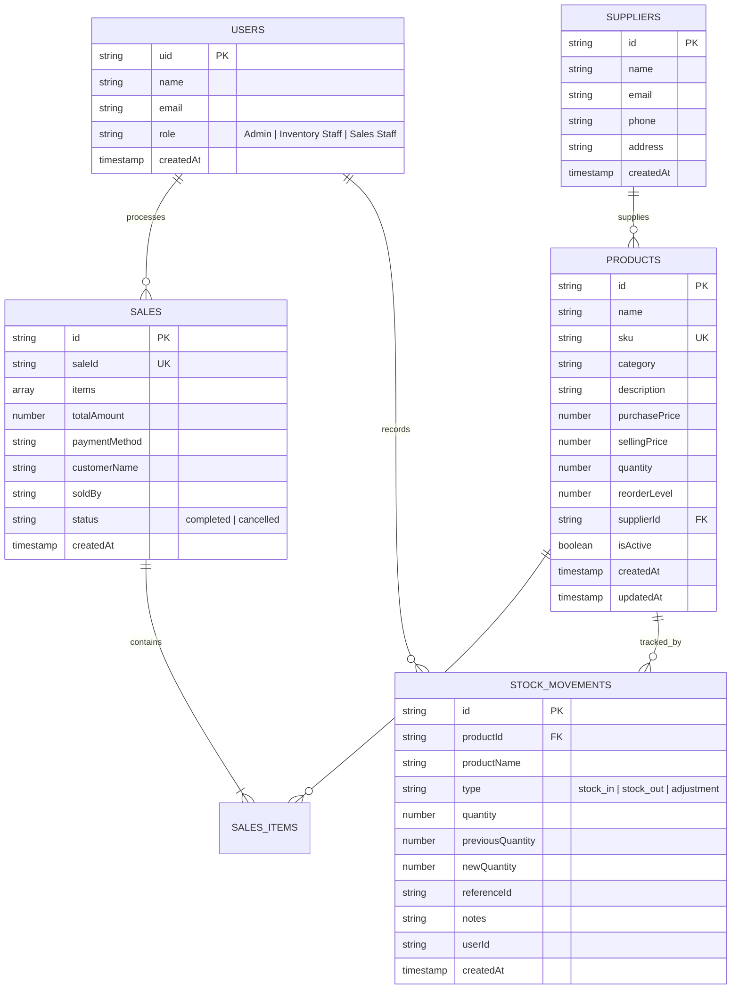

# Firestore Database Schema Specification

## 1. Database Model
The system uses **Google Cloud Firestore**, a flexible, scalable NoSQL document database. Primary documents are stored in 5 top-level collections.

---

## 2. Collection Details & Field Definitions

### Collection: `users`
Stores user profile information and security role claims. Passwords are never stored here (managed by Firebase Authentication).
- **Document ID:** Firebase Auth UID
- **Fields:**
  - `uid` *(string)*: Unique user identifier matching Firebase Auth UID.
  - `name` *(string)*: Full display name (e.g. "Sarah Connor").
  - `email` *(string)*: Registered email address.
  - `role` *(string)*: Role designation: `"Admin"`, `"Inventory Staff"`, or `"Sales Staff"`.
  - `department` *(string, optional)*: Team or branch.
  - `createdAt` *(timestamp)*: Account creation date.

---

### Collection: `products`
The central retail product catalogue.
- **Document ID:** Auto-generated Firestore ID
- **Fields:**
  - `name` *(string)*: Product title (e.g. "Mechanical Gaming Keyboard").
  - `sku` *(string)*: Unique stock keeping unit code (e.g. "ELE-2089").
  - `category` *(string)*: Classification (e.g. "Electronics", "Packaging", "Office Supplies").
  - `description` *(string)*: Detailed product specifications.
  - `purchasePrice` *(number)*: Wholesale unit purchase cost (e.g. 28.00).
  - `sellingPrice` *(number)*: Retail counter price (e.g. 59.99).
  - `quantity` *(number)*: Current available stock units on hand.
  - `reorderLevel` *(number)*: Minimum threshold triggering low-stock replenishment warnings.
  - `supplierId` *(string)*: Associated document ID from `suppliers`.
  - `isActive` *(boolean)*: Active flag (soft deletion flag when false).
  - `createdAt` *(timestamp)*: Record creation timestamp.
  - `updatedAt` *(timestamp)*: Last updated timestamp.

---

### Collection: `suppliers`
Directory of wholesale trade suppliers and distributors.
- **Document ID:** Auto-generated Firestore ID
- **Fields:**
  - `name` *(string)*: Company name (e.g. "Apex Wholesale Supplies").
  - `email` *(string)*: Order inquiry email.
  - `phone` *(string)*: Contact telephone number.
  - `address` *(string)*: Warehouse or distribution facility address.
  - `createdAt` *(timestamp)*: Record creation timestamp.

---

### Collection: `sales`
Transaction receipts for customer checkouts.
- **Document ID:** Auto-generated Firestore ID
- **Fields:**
  - `saleId` *(string)*: Human-readable receipt invoice number (e.g. "INV-2024-001").
  - `items` *(array of objects)*:
    - `productId` *(string)*: Product ID reference.
    - `name` *(string)*: Name of product at time of sale.
    - `quantity` *(number)*: Units purchased.
    - `unitPrice` *(number)*: Selling price charged.
    - `subtotal` *(number)*: Calculated `quantity * unitPrice`.
  - `totalAmount` *(number)*: Sum total charged.
  - `paymentMethod` *(string)*: `"Cash"`, `"Card"`, or `"Digital"`.
  - `customerName` *(string)*: Customer name or "Walk-in Customer".
  - `soldBy` *(string)*: Cashier name or UID.
  - `status` *(string)*: `"completed"` (immutable).
  - `createdAt` *(timestamp)*: Sale completion timestamp.

---

### Collection: `stockMovements`
Immutable append-only audit trail recording every inventory change.
- **Document ID:** Auto-generated Firestore ID
- **Fields:**
  - `productId` *(string)*: Product document ID.
  - `productName` *(string)*: Snapshot of product name.
  - `type` *(string)*: Movement category:
    - `"stock_in"`: Replenishment received from vendor.
    - `"stock_out"`: Units deducted via customer sale.
    - `"adjustment"`: Discrepancy correction, damaged write-off, or return.
  - `quantity` *(number)*: Delta units (+/-).
  - `previousQuantity` *(number)*: Count before transaction.
  - `newQuantity` *(number)*: Count after transaction.
  - `referenceId` *(string)*: Reference PO number, Sales ID, or "ADJUSTMENT".
  - `notes` *(string)*: Descriptive reason or remarks.
  - `userId` *(string)*: Operator who executed the transaction.
  - `createdAt` *(timestamp)*: Server timestamp.
