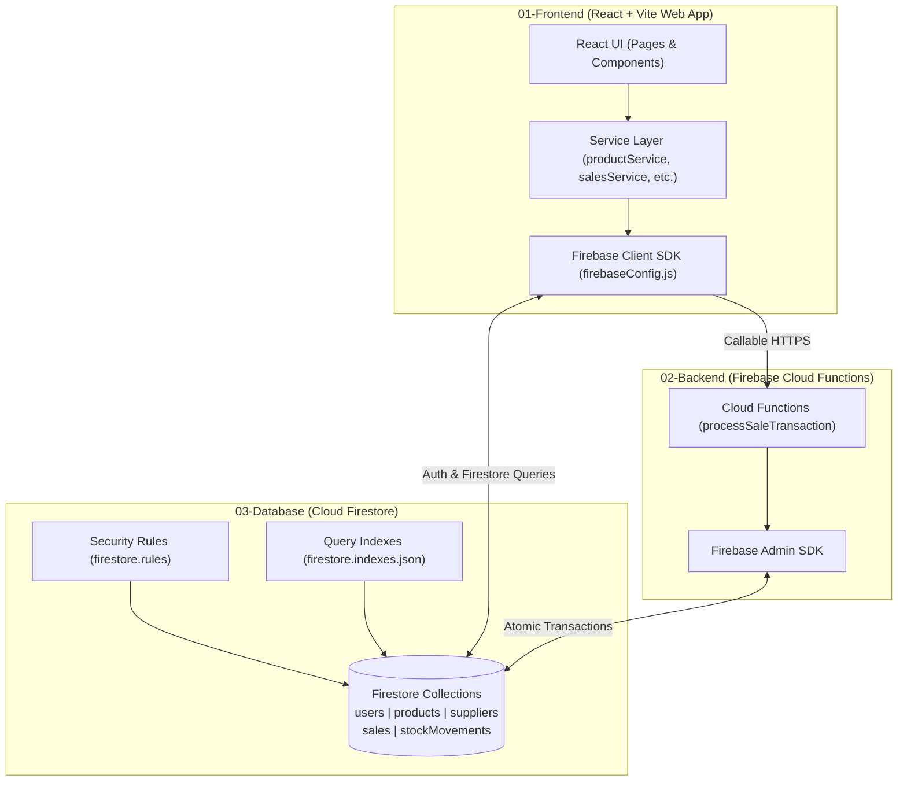

# Smart Inventory and Sales Management System
**University Information System Project — Component-Separated Submission**

---

## 1. Project Overview & Architecture

This project is a web-based information system engineered for small retail businesses transitioning from error-prone manual spreadsheets to a centralized, role-governed management platform.

To meet university submission standards, the project is structured into **three clearly separated, modular components**:



---

## 2. Component Separation & Structure

```
Inventory_System/
│
├── 01-Frontend/                    # Component 1: Client Application
│   ├── public/                     # Static assets
│   ├── src/                        # React source code
│   │   ├── components/             # Reusable UI widgets (Navbar, Sidebar, Tables, Forms)
│   │   ├── pages/                  # Application views (Login, Dashboard, Products, etc.)
│   │   ├── layouts/                # DashboardLayout and shell structure
│   │   ├── services/               # Firestore queries & business logic operations
│   │   ├── firebase/               # firebaseConfig.js (Client SDK initialization)
│   │   ├── hooks/                  # useAuth.jsx (Role verification & session state)
│   │   └── utils/                  # Formatters, currency, date, and SKU helpers
│   ├── .env                        # Environment configuration
│   ├── index.html                  # HTML5 entry template
│   ├── package.json                # Frontend dependencies
│   ├── vite.config.js              # Vite build & chunking configuration
│   └── README.md                   # Component 1 detailed documentation
│
├── 02-Backend/                     # Component 2: Server Business Logic
│   ├── src/
│   │   └── index.ts                # TypeScript Cloud Functions (processSaleTransaction)
│   ├── package.json                # Cloud Functions dependencies
│   ├── tsconfig.json               # TypeScript compiler options
│   └── README.md                   # Component 2 detailed documentation
│
├── 03-Database/                    # Component 3: Persistent Data & Rules
│   ├── firestore.rules             # Role-based access security rules
│   ├── firestore.indexes.json      # Compound query indexes
│   ├── schema/
│   │   └── COLLECTIONS.md          # Entity-Relationship diagram & schema reference
│   ├── sample-data/                # University evaluation datasets (JSON format)
│   │   ├── users.json              # Test user accounts
│   │   ├── products.json           # Catalog items with pricing & thresholds
│   │   ├── suppliers.json          # Trade vendor records
│   │   ├── sales.json              # Historical sale transaction receipts
│   │   └── stockMovements.json     # Immutable movement audit logs
│   ├── scripts/
│   │   ├── package.json            # Seed utility configuration
│   │   └── seedDatabase.js         # Node.js Firestore seed utility
│   └── README.md                   # Component 3 detailed documentation
│
├── 04-UI-UX-Design/                # Component 4: Figma Design System & Specification
│   ├── FIGMA-DESIGN-SPECIFICATION.md# Master design specification & prototype matrix
│   ├── tokens/
│   │   └── figma-tokens.json       # Importable Figma tokens (Colors, Typography, Spacing)
│   ├── vector-artboards/           # 9 editable SVG artboards ready to import into Figma
│   └── README.md                   # Figma assembly and presentation guide
│
├── firebase.json                   # Root Firebase configuration linking all 3 components
├── .gitignore                      # Git ignore rules for all components
├── package.json                    # Root orchestration scripts
└── PROJECT-README.md               # Master submission documentation (this document)
```

---

## 3. How the Three Components Integrate

1. **Integrated, Not Disconnected:** All three components share the same **Cloud Firestore** schema and **Firebase Authentication** provider.
2. **Frontend ↔ Database:** The frontend reads and writes documents through dedicated service files (`productService.js`, `inventoryService.js`, etc.) using the client SDK initialized in `01-Frontend/src/firebase/firebaseConfig.js`. Access is governed by `03-Database/firestore.rules`.
3. **Frontend ↔ Backend:** Critical transactions (such as customer sales with automated stock deduction) can be dispatched to `02-Backend`'s `processSaleTransaction` Cloud Function.
4. **Backend ↔ Database:** `02-Backend` connects to `03-Database` via the privileged `firebase-admin` SDK, executing atomic multi-document transactions to check stock, decrement inventory, and write audit logs.

---

## 4. University Requirements Coverage (FR1 – FR10)

| Requirement | Description | Implementing Component | Key Files |
| :--- | :--- | :--- | :--- |
| **FR1 — User Access** | Role-based authentication (Admin, Inventory Staff, Sales Staff) | `01-Frontend`, `03-Database` | `src/hooks/useAuth.jsx`, `firestore.rules` |
| **FR2 — Product Catalogue** | Create, view, update, and deactivate products | `01-Frontend`, `03-Database` | `src/pages/Products.jsx`, `productService.js` |
| **FR3 — Stock Management** | Record stock received and physical adjustments | `01-Frontend`, `02-Backend` | `src/pages/Inventory.jsx`, `inventoryService.js` |
| **FR4 — Supplier Records** | Contact info and association with products | `01-Frontend`, `03-Database` | `src/pages/Suppliers.jsx`, `supplierService.js` |
| **FR5 — Sales Transactions** | Multi-item customer sales at the counter | `01-Frontend`, `02-Backend` | `src/pages/Sales.jsx`, `salesService.js` |
| **FR6 — Automatic Stock Update** | Stock decrement with insufficient stock prevention | `02-Backend`, `01-Frontend` | `02-Backend/src/index.ts`, `salesService.js` |
| **FR7 — Low-Stock Alerts** | Automated identification of items at or below reorder level | `01-Frontend` | `Navbar.jsx`, `Dashboard.jsx`, `formatters.js` |
| **FR8 — Transaction History** | Immutable audit logs for sales and movements | `01-Frontend`, `03-Database` | `stockMovements` collection, `Inventory.jsx` |
| **FR9 — Reports & Dashboard** | Sales trends, financial valuation, and best sellers | `01-Frontend` | `src/pages/Dashboard.jsx`, `Reports.jsx` |
| **FR10 — Validation & Feedback** | Required field validation, user error & success feedback | `01-Frontend`, `02-Backend` | Form validators, Toast notifications |

---

## 5. Supervisor Quick Evaluation Accounts

The system includes instant 1-click test credentials on the Login screen and a **Supervisor Role Switcher** widget in the Sidebar:

| Role | Test Account Name | Email | Password | Access Scope |
| :--- | :--- | :--- | :--- | :--- |
| **Admin** | Sarah Connor | `admin@inventory.edu` | `demo123` | Full access across all modules |
| **Inventory Staff** | Michael Chen | `inventory@inventory.edu` | `demo123` | Product catalog, stock-in, adjustments, suppliers |
| **Sales Staff** | Amina Patel | `sales@inventory.edu` | `demo123` | Point of Sale (POS) counter, customer sales history |

---

## 6. How to Run the Application

### Option A: From the Project Root
```bash
# Start the Frontend Development Server
npm run dev:frontend

# Build the Frontend for Production
npm run build:frontend

# Compile the Backend Functions
npm run build:backend
```

### Option B: Directly Inside Component Folders
```bash
# 1. Run the Frontend
cd 01-Frontend
npm install
npm run dev
# -> Opens http://localhost:5173

# 2. Build the Backend
cd 02-Backend
npm install
npm run build

# 3. Test Database Scripts
cd 03-Database/scripts
node seedDatabase.js
```

---

## 7. Packaging for University Submission

To produce the final ZIP deliverable for the supervisor:
1. Ensure `node_modules` are excluded (or preserved if the supervisor requested an offline bundle).
2. Right-click the root `Inventory_System` folder and choose **Send to → Compressed (zipped) folder** (or run `tar -a -c -f Smart_Inventory_System.zip *`).
3. The resulting archive contains all three identifiable components (`01-Frontend`, `02-Backend`, `03-Database`) alongside root configuration files and documentation.
